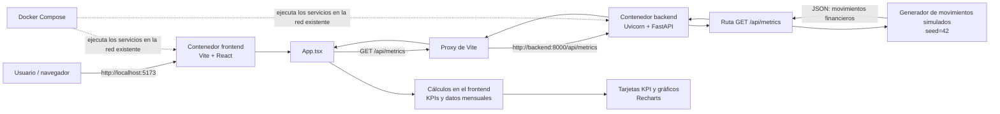

# Mapa de conexiones del proyecto

Este documento describe únicamente las conexiones que ya existen en el proyecto.
Es un mapa informativo: no implementa ni configura conexiones nuevas.

Consulta el [registro de verificaciones](REGISTRO_VERIFICACIONES.md) para
distinguir relaciones comprobadas en código, pruebas ejecutadas y verificaciones
pendientes. Este diagrama no certifica que los servicios estén activos.

## Diagrama



## Cómo viaja la información

1. Docker Compose inicia los contenedores `frontend` y `backend`. La dependencia
   `depends_on` hace que Compose inicie el backend antes que el frontend.
2. El navegador abre el frontend en `http://localhost:5173`.
3. La aplicación React (`frontend/src/App.tsx`) solicita `GET /api/metrics`.
4. Vite reenvía las peticiones que empiezan por `/api` a
   `http://backend:8000` dentro de la red de Docker Compose. Por eso el navegador
   usa una ruta relativa y no necesita conocer el nombre interno del backend.
5. FastAPI responde con movimientos financieros en formato JSON. Los datos se
   generan en el backend; no se leen de una base de datos.
6. El frontend calcula ingresos, gastos, ganancias, margen y agrupaciones por
   mes, y los presenta en tarjetas y gráficos.

## Servicios y puertos

| Servicio | Dirección desde el navegador/equipo | Uso |
| --- | --- | --- |
| Frontend | `http://localhost:5173` | Interfaz React servida por Vite |
| API backend | `http://localhost:8000` | FastAPI y sus endpoints |
| Depurador Python | puerto `5678` | Puerto de `debugpy` para depuración |
| Documentación de la API | `http://localhost:8000/docs` | Documentación interactiva de FastAPI |

Dentro de Docker, el frontend se comunica con el backend usando el nombre de
servicio `backend` y el puerto `8000`. Los puertos publicados permiten acceder a
los servicios desde el equipo anfitrión.

## Conexiones disponibles en la API

La pantalla principal actualmente consume `GET /api/metrics`. El backend también
ofrece estas rutas, que no están conectadas a la pantalla principal en
`App.tsx`:

- `GET /api/metrics/facets`: opciones de filtros y rango de fechas.
- `GET /api/metrics/summary`: resumen agrupado por día, semana o mes.
- `GET /api/metrics/categories/top`: categorías con mayores totales.
- `GET /api/metrics/comparison`: comparación entre dos periodos.
- `GET /api/metrics/alerts`: alertas por aumento de gastos.
- `GET /api/metrics/b2b` y `GET /api/metrics/b2c`: movimientos por segmento.
- `GET /health`: comprobación básica de estado del backend.

## Qué no está conectado

- No hay una base de datos: los movimientos son datos simulados generados por
  `backend/app/routes.py`.
- La pantalla principal no solicita los resúmenes, comparaciones, alertas ni
  filtros avanzados; calcula sus indicadores a partir de `/api/metrics`.
- `frontend/src/lib/mock-data.ts` contiene datos de ejemplo adicionales, pero
  `App.tsx` obtiene los datos de la API.

> **Nota para la presentación:** el encabezado del dashboard muestra “2024 -
> Full Year”, pero las fechas de la API se generan según la fecha actual. La
> etiqueta del periodo y el rango de datos podrían no coincidir.

## Cómo iniciar el proyecto

Desde la raíz del repositorio:

```bash
docker compose up --build
```

La configuración del proxy está en `frontend/vite.config.ts`; los servicios y
puertos publicados están definidos en `docker-compose.yml`.
